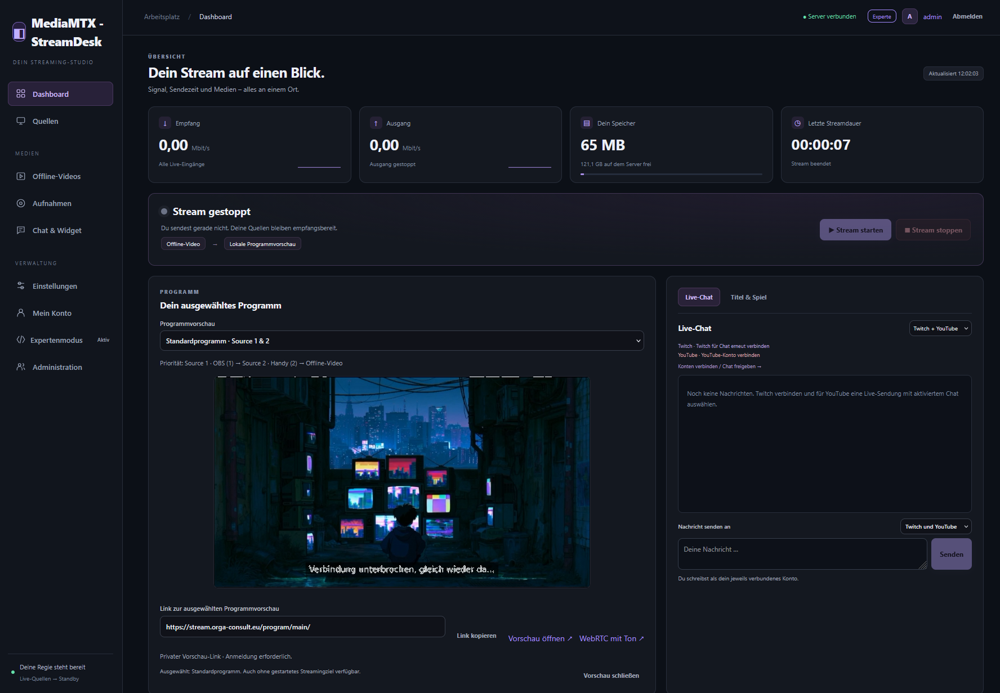
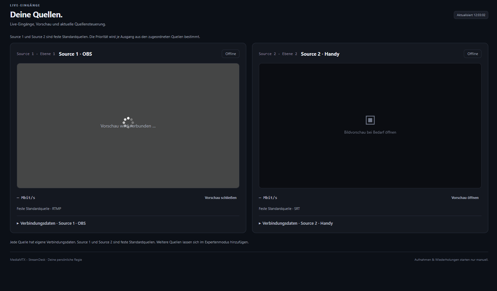
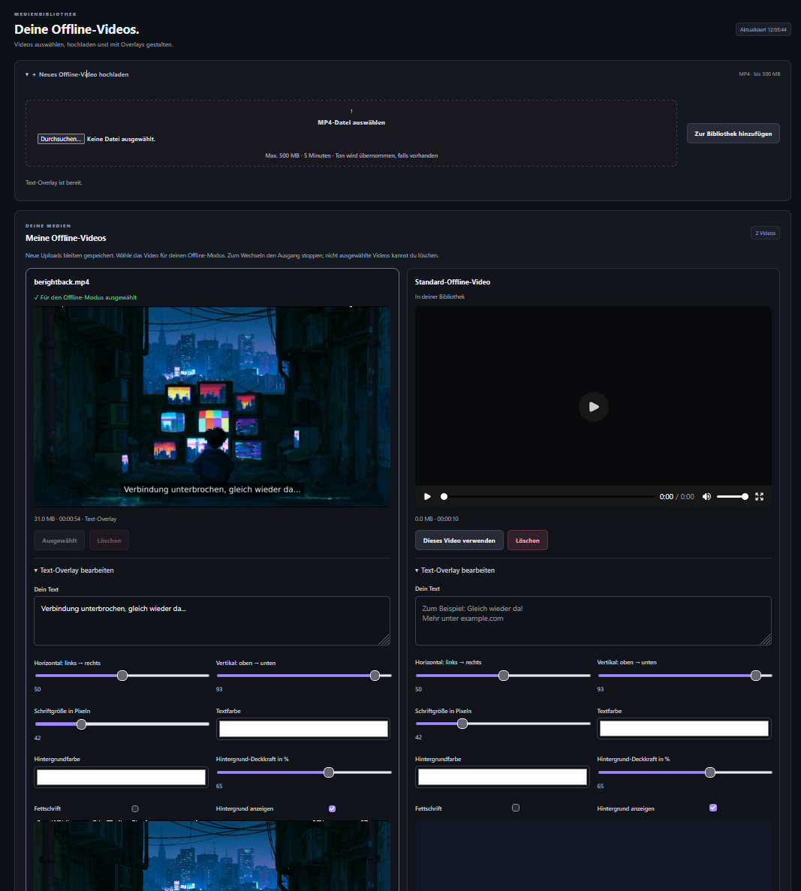
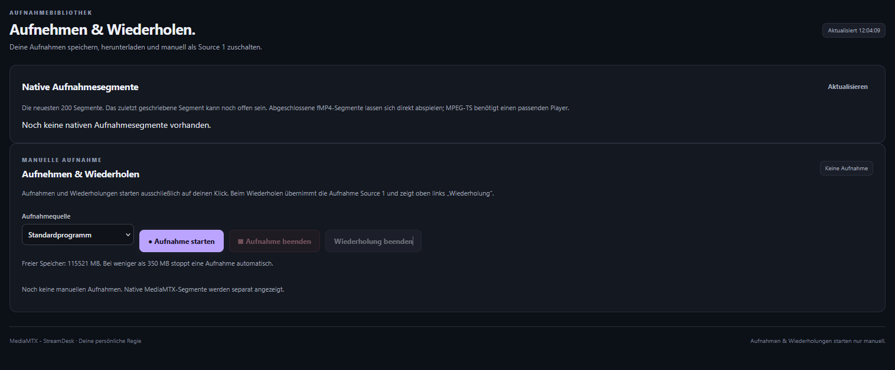
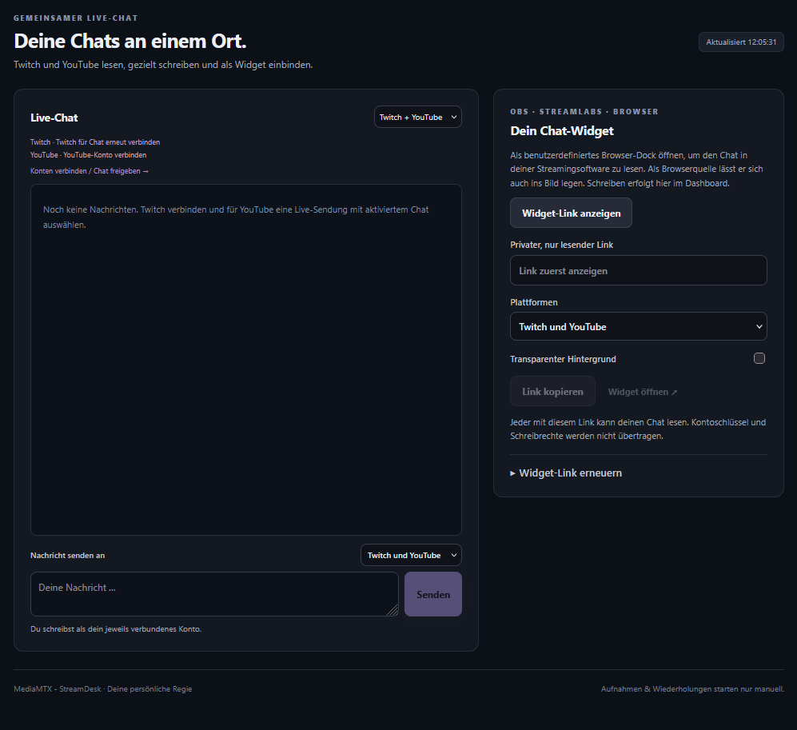
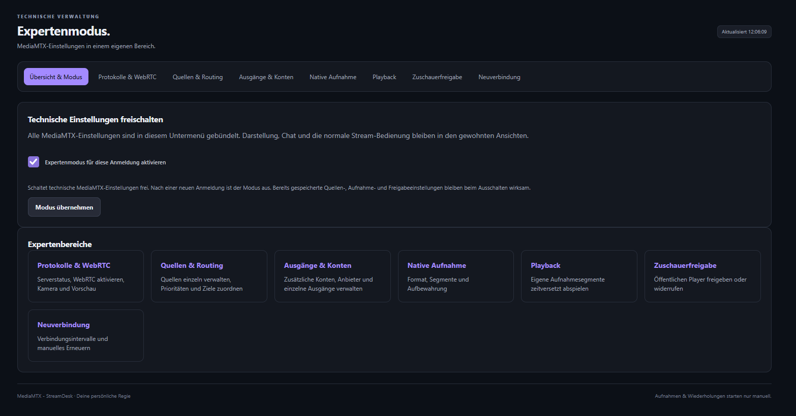

# MediaMTX - StreamDesk

**Aktuelle Version: 1.1.6**

Eine selbst gehostete Mehrbenutzer-Oberfläche für OBS-/Handy-Streams, manuelle Aufnahmen, Offline-Videos, Multistreaming und gemeinsamen Twitch-/YouTube-Chat.

**MediaMTX - StreamDesk benötigt [MediaMTX](https://github.com/bluenviron/mediamtx).** MediaMTX übernimmt den eigentlichen Medienverkehr. StreamDesk steuert persönliche Eingänge, automatische Quellenwahl und Ausgänge über dessen Control API. Dies ist ein eigenständiges Community-Projekt und kein offizieller Bestandteil von MediaMTX, Twitch oder YouTube.

```text
Standard: Source 1 → Source 2 → Offline
          └── Twitch / YouTube / eigener Anbieter

Expertenmodus: zusätzliche Quellen und Konten
              └── pro Ausgang eigene Quellenzuordnung und Priorität
```

## Funktionen

- Eigener Expertenmodus mit Untermenüs für technische MediaMTX-Einstellungen und zusätzlicher serverseitiger Prüfung; nach jeder neuen Anmeldung ausgeschaltet. Globale MediaMTX-Einstellungen benötigen zusätzlich Administratorrechte.
- Zentrale Dienstfreigaben unter **Administration → Dienste & Freigaben**: Nur Administratoren können Funktionen für alle Benutzer sperren; Zugangsdaten, Einstellungen und Aufnahmen bleiben erhalten.
- Quellen und Prioritäten pro Ausgang, einzelne Streamingziele starten/stoppen, WebRTC-Kamera/-Vorschau, native segmentierte Aufnahmen und widerrufbare öffentliche HLS-Zuschauer-Links im Expertenmodus.
- Geschützte zeitversetzte Wiedergabe eigener nativer Aufnahmen, mit optionalem Playback-Server und Ausschnitten bis zu einer Stunde.
- Helles, dunkles oder System-Theme pro Benutzer sowie mobile Bedienelemente, immer verfügbar.
- Kompaktes Dashboard mit Empfangs-/Sendedatenrate, aktuellem Programm, eigener Medienbelegung sowie aktueller und gesamter erfasster Sendezeit.
- Persönliche Konten mit zwei festen Standardquellen: Source 1 vor Source 2. Zusätzliche Publish-/öffentliche RTSP-Pull-Quellen werden nur im Expertenmodus angelegt.
- Persönliche Offline-Videobibliothek: MP4 bis 500 MiB und fünf Minuten, Auswahl, Vorschau und Löschen. Die Offline-Schleife läuft bei Programmvorschau, Programmaufnahme oder aktivem Ausgang.
- Positionierbare Textbeschriftung und live gerenderte Browser-Overlays, etwa von StreamElements. Der Overlay-Browser liefert Bild und Animationen; dessen Audio wird nicht übernommen.
- Umschaltbare Programmvorschau je Ausgang mit sichtbarem privatem Link im Dashboard; auch ohne Streamingziel verfügbar.
- Dauerhafter Programmpfad; Programmaufnahmen laufen beim Wechsel zwischen Quellen und Offline-Video weiter.
- Separate manuell gestartete Aufnahmen, MP4-Download und einmalige Wiedergabe als Source 1 mit sichtbarem Hinweis „Wiederholung“.
- Standardausgänge Twitch, YouTube und ein eigener Anbieter; im Expertenmodus weitere Konten/Anbieter hinzufügen. Bis zu zehn Quellen und zehn Ausgänge insgesamt. Die gespeicherte Zielauswahl gilt beim nächsten Start; Konten bleiben beim Abwählen verbunden.
- Optionale Erneuerung der Twitch-Verbindung, während andere Streamingziele verbunden bleiben.
- Twitch-Titel und Kategorie bearbeiten; YouTube-Konto und eigene Sendung auswählen.
- Sichtbarer Bereich „Mein Konto“ für den eigenen Passwortwechsel; Administration mit Löschung deaktivierter Konten und separatem Medienarchiv.
- Getrennte Einstellungen für Twitch, YouTube und eigenen Anbieter; Discord-Bot-Einrichtung mit Anleitung im Expertenmodus.
- Gemeinsamer Chat mit gezieltem Senden an Twitch, YouTube oder beide; persönliches, erneuerbares Widget für Browser-Docks und Browserquellen.

## Screenshots

### Dashboard

Streamstatus, umschaltbare Programmvorschau mit privatem Link und gemeinsamer Live-Chat auf einen Blick.



<details>
<summary>Quellen – getrennte Vorschauen und Verbindungsdaten</summary>



</details>

<details>
<summary>Offline-Videos – Bibliothek und Text-Overlays</summary>



</details>

<details>
<summary>Aufnahmen – Programm aufzeichnen und Aufnahmen wiederholen</summary>



</details>

<details>
<summary>Chat und Widget – Twitch und YouTube gemeinsam</summary>



</details>

<details>
<summary>Expertenmodus – eigene Untermenüs für technische Einstellungen</summary>



</details>

## Installation

Unterstützt werden **Debian 12/13 mit systemd und Python ab 3.11**, auf amd64 und arm64. Empfohlen wird ein eigener Debian-Server bzw. Proxmox-LXC. Der Installer benötigt root und Internetzugang.

Das ZIP entpacken, in den entpackten Ordner wechseln und den passenden Modus wählen. Es müssen keine vorhandenen StreamDesk-Dateien, Videos oder Schlüssel kopiert werden.

### Vorhandenes MediaMTX einbinden

```bash
sudo bash install.sh --mode attach \
  --public-url https://stream.example.com \
  --ingest-host ingest.example.com \
  --mediamtx-config /opt/mediamtx/mediamtx.yml \
  --mediamtx-binary /opt/mediamtx/mediamtx
```

Der Installer ersetzt weder das vorhandene MediaMTX-Programm noch dessen Dienst. Fremde Pfade bleiben bestehen. Es wird ein eigener reservierter Namensbereich `streamdesk/<benutzer>/` angelegt. Vorhandene globale Medienberechtigungen werden so eingegrenzt, dass sie diesen privaten Namensbereich nicht öffnen; ihre Wirkung auf die bisherigen Pfade bleibt erhalten. Details und Einschränkungen stehen in [INSTALL.md](INSTALL.md).

### StreamDesk und MediaMTX gemeinsam neu installieren

```bash
sudo bash install.sh --mode standalone \
  --public-url https://stream.example.com \
  --ingest-host ingest.example.com
```

Dabei lädt der Installer das offizielle MediaMTX **v1.21.3** für die erkannte Architektur herunter und prüft dessen fest hinterlegte SHA-256-Prüfsumme. Es werden getrennte systemd-Dienste, ein virtuelles Python-Environment und ein eigenes stummes Standby-Video erstellt. Vorhandene MediaMTX-Dateien oder StreamDesk-Daten werden im Neuinstallationsmodus nicht überschrieben.

Erste Zugangsdaten nach erfolgreicher Installation:

```bash
sudo cat /var/lib/streamdesk/initial-login.txt
```

Es gibt kein öffentliches Standardpasswort. Das Administratorkonto wird mit einem zufälligen Passwort angelegt. Danach das Passwort in der Oberfläche ändern und die Datei mit dem initialen Passwort entfernen.

**Ausführliche Schritte: [INSTALL.md](INSTALL.md).** Weitere Dokumentation:

- [Feature-Übersicht und Roadmap](FEATURE.md)
- [Expertenmodus und neue Medienfunktionen](docs/EXPERT_MODE.md)
- [OBS und SRT-Verbindungsprobleme](docs/SRT.md)
- [Reverse Proxy und NPMplus](docs/PROXY.md)
- [Twitch- und Google-/YouTube-Kontofreigabe](docs/OAUTH.md)
- [Discord-Bot erstellen und im Expertenmodus verbinden](docs/DISCORD.md)
- [Dienste als Administrator global sperren und freigeben](docs/ADMIN_SERVICES.md)
- [Konfigurationsvariablen](docs/CONFIGURATION.md)
- [Authentifizierung und Spezialprotokolle](docs/AUTH_PROTOCOLS.md)
- [Automation, Zeitplan und Export](docs/AUTOMATION.md)
- [MediaMTX-Kompatibilitätsmatrix](docs/MEDIAMTX_COMPATIBILITY.md)
- [Betrieb, Updates, Sicherung und Wiederherstellung](docs/OPERATIONS.md)
- [Neu aufsetzen nach gelöschter Datenbank](INSTALL.md#datenbank-gelöscht-neue-instanz-an-bestehendem-mediamtx)
- [Mitwirken und Tests](CONTRIBUTING.md)
- [Prüfbericht zu diesem Release](TESTING.md)
- [Sicherheit](SECURITY.md)
- [Änderungen](CHANGELOG.md)

## Erste Verwendung

1. Oberfläche über die konfigurierte öffentliche Adresse öffnen und anmelden.
2. In „Quellen“ die persönlichen OBS-/SRT-Verbindungsdaten anzeigen und im Encoder eintragen.
3. Unter „Einstellungen“ die gewünschten Konten oder Streamschlüssel hinterlegen. Für YouTube einen Livestream im YouTube Studio vorbereiten.
4. „Beim nächsten Stream senden an“ wählen und **Streaming-Auswahl speichern**. Neue Verbindungen aktivieren kein Streamingziel automatisch.
5. Im Dashboard **Stream starten**. **Stream stoppen** beendet die Weiterleitungen, ohne Kontofreigaben oder Schlüssel zu löschen.
6. Aufnahmen und Wiederholungen separat und ausschließlich manuell starten.
7. Für technische Erweiterungen den eigenen Menüpunkt **Expertenmodus** öffnen, den Modus einschalten und **Modus übernehmen**. Die technischen Einstellungen liegen ausschließlich in dessen Untermenüs. Theme und normale Bedienung benötigen ihn nicht.

Jeder Benutzer besitzt eigene Eingänge, Videos, Aufnahmen, Verbindungen und Chat-Widget-Links. Die Administratorverwaltung legt weitere Benutzer an.

## Grenzen

- Eine neue Twitch-Sitzung ist nicht garantiert unterbrechungsfrei. Eine kurze Neuverbindung setzt die Twitch-Grenze von 48 Stunden nicht zuverlässig zurück. Disconnect-Schutz und eine neue Sendung sind unterschiedliche Dinge.
- API-Kontofreigaben bei Twitch/Google sind für Chat erforderlich. YouTube-Streaming per Schlüssel benötigt keine Google-App. Eine YouTube-Sendung mit deaktiviertem oder beendetem Chat liefert keinen aktiven Chat.
- Die Anwendung erstellt, veröffentlicht oder beendet keine YouTube-Sendung automatisch über die API. Die Autostart-Einstellungen im YouTube Studio gelten weiterhin.
- Direkte MP4-Aufnahmen einer einzelnen Quelle werden bei deren Abbruch abgeschlossen. Programmaufnahmen laufen über Quellenwechsel und Offline-Fallback weiter. Bei weniger als 350 MiB freiem Speicher werden Aufnahmen beendet; zum Start müssen mindestens 500 MiB frei sein. Ausdrücklich aktivierte native MediaMTX-Aufnahmen zeichnen wieder auf, sobald die Quelle verfügbar ist.
- Browser-Overlays benötigen während ihrer Nutzung Chromium und zusätzliche CPU/RAM. Eine gemeinsame Videoausgabe wird auf die Ziele verteilt; die Upload-Bandbreite steigt mit deren Anzahl.
- WebRTC benötigt kompatible Browser-/Quellcodecs und einen erreichbaren Medienport. Browser-Kamera-Publish setzt HTTPS voraus. Der Signalisierungsproxy öffnet keine Firewallports automatisch; Einrichtung siehe [Expertenmodus](docs/EXPERT_MODE.md).
- Für native Installationen bleibt eine lokale MediaMTX-Instanz der Standard. Eine entfernte Instanz kann mit `--remote-mediamtx`, HTTPS-Control-API, lokaler Konfigurationsspiegelung und festen `--mediamtx-client-ip`-Adressen angebunden werden; StreamDesk beschreibt keine entfernte Datei direkt.
- Für Labor- und Cloud-Setups liegt [compose.yml](compose.yml) mit getrennten Diensten, persistenten Volumes und Healthchecks bei.

## Lizenz und Abhängigkeiten

StreamDesk wird unter der [MIT-Lizenz](LICENSE) bereitgestellt. MediaMTX bleibt ein separates Projekt mit eigener MIT-Lizenz. Die YouTube-gRPC-Protokolldefinition und generierter Code beruhen auf Googles Apache-2.0-Beispiel; siehe [NOTICE](NOTICE) und [Lizenztext](LICENSE.youtube-sample.txt). Weitere Laufzeit-Abhängigkeiten stehen in `requirements.txt` und [THIRD_PARTY.md](THIRD_PARTY.md).

Im Release-ZIP sind ausschließlich Quellcode und Dokumentation enthalten: keine Serverdatenbank, Konten, Kennwörter, Streamschlüssel, OAuth-Secrets, privaten Widget-Links oder hochgeladenen Videos.

Die verbindliche Erweiterungsplanung steht in [ROADMAP.md](ROADMAP.md), unabhängig von der Feature-Liste. Die Wellen nach 1.1.0 sind weiterhin Planung.

Die technische Prüfung vor dem Versionswechsel zu 1.1.5 und ihre Prüfgrenzen stehen im [Review vom 27. Oktober 2026](docs/REVIEW_2026-10-27.md). Die anschließenden Oberflächenänderungen sind im [Release-Prüfbericht](TESTING.md) beschrieben. HTTP-/JWT-Umschaltung bleibt gesperrt; Docker-/Remote-Betrieb ist ergänzend zur geprüften lokalen Installation vorgesehen.
